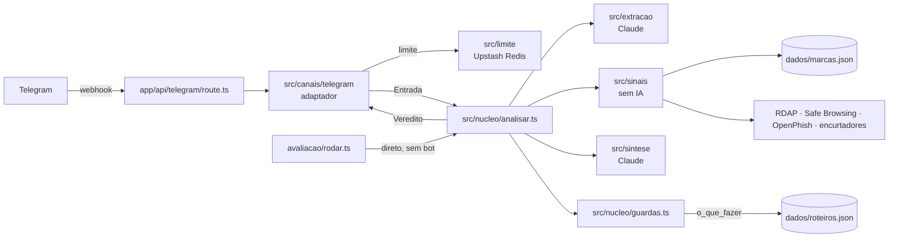

# Modelagem

Contratos, fluxo e divisão de arquivos do É golpe?. Os tipos estão em [`src/nucleo/tipos.ts`](../src/nucleo/tipos.ts), que é a fonte da verdade: este documento explica o porquê. Só o orquestrador altera os tipos compartilhados; subagentes propõem mudanças no relatório.

## Componentes



## Sequência de uma análise

```mermaid
sequenceDiagram
  participant U as Pessoa
  participant T as Telegram
  participant W as Webhook (Vercel)
  participant Rd as Redis
  participant N as Núcleo
  U->>T: texto, print ou link
  T->>W: POST /api/telegram (com secret token)
  W->>W: valida X-Telegram-Bot-Api-Secret-Token
  W->>Rd: INCR contador do usuário (hora) e do bot (dia)
  alt passou do limite
    W->>T: orientação básica
  else dentro do limite
    W-->>T: 200 imediato; análise continua em after()
    W->>T: "Analisando..."
    W->>N: analisar(Entrada)
    N->>N: 1. extrair (Claude, saída validada por schema)
    N->>N: 2. verificarSinais (paralelo, timeout curto)
    N->>N: 3. sintetizar (Claude) + guardas + roteiro fixo
    N-->>W: Veredito
    W->>T: veredito + botão "Já paguei / já cliquei"
  end
  U->>T: toca no botão
  T->>W: callback_query (data = "depois:<tipo>")
  W->>T: roteiro "depois" do tipo
```

## Tipos

| Tipo | Papel | Quem produz | Quem consome |
|---|---|---|---|
| `Entrada` | Texto e/ou imagens, sem nada do canal | adaptador | núcleo |
| `Extracao` | Links, chaves Pix, linhas digitáveis, telefones, remetente alegado, pedido de dinheiro, urgência, trechos citáveis | extração | sinais, síntese |
| `Evidencia` | Resultado objetivo de um sinal: `alerta`, `confirmacao`, `neutro` ou `sem_resultado`, com descrição em linguagem simples | sinais | síntese, guardas |
| `Sinal` | Interface de cada verificação: `verificar(extracao, ctx)`, nunca lança | sinais | `verificarSinais` |
| `ResultadoSintese` | Nível, tipo e motivos escolhidos pelo modelo | síntese | guardas |
| `Veredito` | Contrato com os adaptadores (`nivel`, `tipo`, `motivos`, `o_que_fazer`) | guardas | adaptadores |
| `Marca` | Domínios oficiais, nome popular, palavras-chave, telefones, código do banco | `dados/marcas.json` | sinais |
| `Roteiro` | Passos `antes` e `depois` por tipo de golpe | `dados/roteiros.json` | guardas, adaptador |
| `CasoDeAvaliacao` | Caso sintético com nível e tipo esperados | `avaliacao/casos.json` | `avaliacao/rodar.ts` |

### Decisões

- **`sem_resultado` ≠ `neutro` ≠ `confirmacao`.** Só `confirmacao` pode apoiar 🟢. `neutro` (ex.: não está no Safe Browsing) não é evidência de segurança. `sem_resultado` (RDAP fora do ar) não sustenta nada.
- **A síntese não escreve `o_que_fazer`.** Ela devolve `ResultadoSintese`; o núcleo copia `Roteiro.antes` do tipo escolhido (`src/nucleo/guardas.ts`).
- **Guardas em código, depois do modelo** (`aplicarGuardas`): motivo sem evidência é descartado; 🟢 com qualquer `alerta` vira 🟡; 🔴/🟡 sem motivo vira 🟡 com motivo genérico; 🟢 sempre tem tipo `nenhum`.
- **Falha nunca vira 🟢.** Erro, timeout ou recusa em qualquer etapa → `vereditoDeFalha()` (🟡 + orientação básica). `analisar()` nunca lança.
- **Botão "Já paguei / já cliquei"** usa `callback_data = "depois:<tipo>"` e `passosDepois(tipo)`. Assim o contrato `Veredito` continua com as 4 chaves do README e nada do usuário precisa ser guardado entre mensagens.
- **Tempo:** o webhook responde 200 na hora e analisa dentro de `after()` (Next.js), para o Telegram não reenviar a atualização. `maxDuration` da rota: 60 s. Prazo do núcleo: 50 s; dos sinais: 8 s no total, cada chamada externa com 3–4 s.
- **Modelo** vem de `MODELO_CLAUDE` (padrão `claude-haiku-5-5`) ou de `OpcoesAnalise.modelo` (avaliação).
- **Injeção de dependências:** `analisarDetalhado(entrada, { etapas, cliente, fetch, agora })` permite testar sem rede e permite à avaliação ver extração e evidências.

## Funções públicas

| Módulo | Função | Contrato |
|---|---|---|
| `src/nucleo/analisar.ts` | `analisar(entrada, opcoes?) → Promise<Veredito>` | nunca lança |
| | `analisarDetalhado(entrada, opcoes?) → Promise<AnaliseDetalhada>` | para avaliação |
| `src/extracao/extrair.ts` | `extrair(entrada, deps) → Promise<Extracao>` | lança em falha/recusa/saída inválida |
| `src/sinais/index.ts` | `verificarSinais(extracao, ctx) → Promise<Evidencia[]>` | nunca lança |
| `src/sintese/sintetizar.ts` | `sintetizar(extracao, evidencias, deps) → Promise<ResultadoSintese>` | lança em falha |
| `src/nucleo/roteiros.ts` | `passosAntes(tipo)`, `passosDepois(tipo)`, `ORIENTACAO_BASICA` | |
| `src/nucleo/log.ts` | `registrarAnalise(meta)` | só metadados |

## Dados persistidos

Nada do conteúdo do usuário é persistido. O que existe:

| Onde | O quê | Validade |
|---|---|---|
| Redis | `limite:u:<idTelegram>:<AAAAMMDDHH>` → contador | expira em 1 h |
| Redis | `limite:bot:<AAAAMMDD>` → contador | expira em 24 h |
| `dados/marcas.json` | base de referência de marcas | mantido à mão |
| `dados/roteiros.json` | roteiros por tipo | revisado pela equipe |
| `dados/openphish.json` | feed comunitário do OpenPhish (importado no bundle) | `npx tsx scripts/atualizar-openphish.ts` |
| `avaliacao/casos.json` | casos sintéticos | mantido pela avaliação |

## Divisão de arquivos por frente

| Frente | Arquivos |
|---|---|
| orquestrador | `src/nucleo/**`, `docs/**`, configuração do projeto, README, AGENTS.md |
| `telegram` | `app/api/telegram/**`, `src/canais/telegram/**`, `src/limite/**`, `scripts/configurar-webhook.ts`, `.env.example` |
| `extracao-sintese` | `src/extracao/**`, `src/sintese/**`, `scripts/analisar-exemplo.ts` |
| `sinais` | `src/sinais/**`, `dados/marcas.json`, `dados/openphish.json`, `scripts/atualizar-openphish.ts` |
| `avaliacao` | `avaliacao/**` |
| interface e experiência (equipe) | `dados/roteiros.json`, `app/page.tsx` e estilos da landing |
